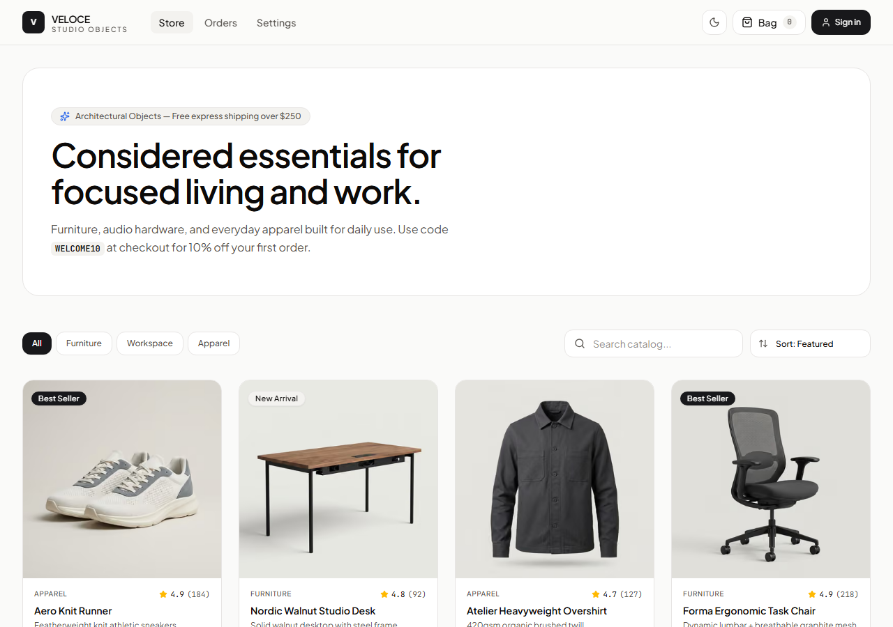
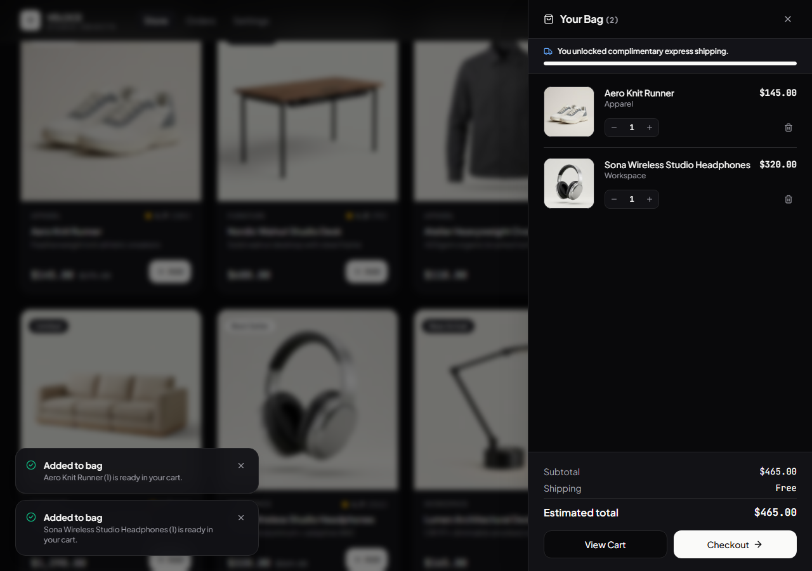

# Veloce Commerce

[](https://github.com/nathangrazo/veloce-commerce-nextjs/actions/workflows/ci.yml)

A full-stack e-commerce app built with **Next.js 16 (App Router)**, **React 19**, **TypeScript**, and **Tailwind CSS 4**.

It started as a web re-interpretation of a React Native Context API storefront and grew into a study on how far you can take native React state management (`Context` + `useReducer` + `useSyncExternalStore`) alongside Next.js Route Handlers before reaching for heavier client state libraries.

> **Live Demo:** _Add your Vercel URL here after deploying (see [Deployment](#deploying-to-vercel) below)._

---

## Preview

| Light Mode Storefront | Dark Mode & Cart Drawer |
| :---: | :---: |
|  |  |

---

## What It Covers

- **Storefront (`/`)**: Category filters, search, sorting, recently viewed strip, and an 8-item catalog.
- **Product Pages (`/products/[slug]`)**: Statically generated product routes (`generateStaticParams`) with specs, quantity controls, and related items.
- **Shopping Cart (Drawer + `/cart`)**: Optimistic add/update/remove, free-shipping progress bar ($250 threshold), and promo codes (`WELCOME10`, `FREESHIP`).
- **Authentication (`/login`)**: Signed HTTP-only session cookie with server-side expiration and automatic merge of the guest cart on sign-in.
- **Checkout (`/checkout`) & Order History (`/orders`)**: Zod-validated shipping form, server-side price recalculation, and persisted order receipts.
- **Settings (`/settings`)**: `light` / `dark` / `system` theme picker, editable shipping profile, and authenticated account data reset.

---

## Notable Engineering Choices

- **Split Contexts for the Cart (`src/contexts/CartContext.tsx`)**: State (`CartStateContext`) and mutations (`CartActionsContext`) live in separate contexts so `ProductCard` components only subscribe to stable callbacks and do not re-render when cart quantities or totals change.
- **Queued Optimistic Mutations (`src/contexts/CartContext.tsx`)**: A naive optimistic rollback saves a snapshot before each request and restores it on error — which causes a race condition if two rapid actions overlap and the first one fails after the second succeeds. To avoid that, cart mutations run through a FIFO promise queue tracked by a monotonic revision counter; if an earlier request fails while a newer one is queued, it never rolls back over the newer mutation, and only reconciles with `GET /api/cart` when the queue drains.
- **External Store Sync (`ThemeContext`, `RecentlyViewedContext`)**: Uses React's `useSyncExternalStore` with explicit server snapshots instead of calling `setState` inside `useEffect`, avoiding hydration mismatches and complying with React 19's strict lint rules.
- **Signed Cookies with Expiry (`src/server/session.ts`)**: Session cookies are signed with HMAC-SHA256 (`crypto.timingSafeEqual`) and checked against a 7-day `iat` TTL on every request. In production, the app throws if `SESSION_SECRET` is missing or shorter than 16 characters.
- **Server-Side Pricing (`src/domain/pricing.ts` + `POST /api/orders`)**: The client preview and the order endpoint share the same pure pricing function. The client never sends prices or totals to the API.
- **Pluggable Persistence (`src/server/store.ts`)**: Uses Upstash Redis / Vercel KV REST (`LPUSH` for orders, per-key JSON for carts and profiles) when environment variables are present, and falls back to a mutex-locked local JSON file (`./data/store.json`) for zero-setup local development.

More detail on each decision is in [`docs/ARCHITECTURE.md`](docs/ARCHITECTURE.md).

---

## Trade-offs & What I Would Change in Production

This is a **production-minded portfolio project**, not a real storefront taking payments. Being explicit about the boundaries:

1. **Single Demo Account vs. Real Auth**: Authentication uses one hardcoded demo user (`demo@veloce.store` / `veloce123`) so reviewers can sign in with one click. In production, I would replace this with a real user table (Argon2/bcrypt password hashes or OAuth via Auth.js/Clerk), refresh token rotation, and per-user rate limiting.
2. **Storage Layer**: Locally, data lives in `./data/store.json` behind an in-process async mutex. That does not scale across multiple server processes. For Vercel deploys, configure Upstash Redis (`UPSTASH_REDIS_REST_URL` / `UPSTASH_REDIS_REST_TOKEN`); for a real store with relational queries and inventory locking, I would move to Postgres (Prisma/Drizzle) with transactional stock decrements.
3. **Simulated Payments**: Checkout records orders directly without calling a payment gateway. In production, this would use Stripe PaymentIntents, server-verified webhooks, and idempotency keys to prevent duplicate charges.
4. **Catalog Source**: Products are typed static data in `src/server/data/products.ts` to keep the demo self-contained. A real store would load inventory from a database or headless CMS with cache revalidation (`revalidateTag`).

---

## Demo Credentials & Promo Codes

| Purpose | Value |
| :--- | :--- |
| **Email** | `demo@veloce.store` |
| **Password** | `veloce123` |
| **10% Discount** | `WELCOME10` |
| **Free Shipping** | `FREESHIP` |

---

## Running Locally

Requires **Node.js 20+** and **npm 10+**.

```bash
git clone https://github.com/nathangrazo/veloce-commerce-nextjs.git
cd veloce-commerce-nextjs
npm install
cp .env.example .env.local
npm run dev
```

Open [http://localhost:3000](http://localhost:3000).

### Available Scripts

| Command | Purpose |
| :--- | :--- |
| `npm run dev` | Start Next.js dev server (Turbopack) |
| `npm run build` | Production build |
| `npm run start` | Serve production build |
| `npm run typecheck` | Run `tsc --noEmit` |
| `npm run lint` | Run ESLint (Next.js Core Web Vitals + React 19 rules) |
| `npm test` | Run Vitest unit & API route tests |
| `npm run test:e2e` | Run Playwright end-to-end checkout test |

---

## Deploying to Vercel

1. Import this repository at [vercel.com/new](https://vercel.com/new).
2. Add a strong random `SESSION_SECRET` (at least 16 characters) in **Settings → Environment Variables**.
3. Connect an **Upstash Redis** integration (from the Vercel Marketplace) so `UPSTASH_REDIS_REST_URL` and `UPSTASH_REDIS_REST_TOKEN` are injected automatically — this ensures carts and orders persist reliably across serverless instances.
4. Deploy.

---

## Project Layout

```text
├── .github/workflows/ci.yml      # Typecheck, lint, Vitest, build, and Playwright E2E
├── docs/
│   ├── ARCHITECTURE.md           # Design notes and trade-offs
│   └── screenshots/              # App screenshots
├── e2e/                          # Playwright end-to-end specs
├── public/images/products/       # Local product photos
└── src/
    ├── app/                      # Next.js App Router pages and API route handlers
    ├── components/               # Reusable UI controls and layout shell
    ├── contexts/                 # Theme, Toast, Auth, Cart, RecentlyViewed contexts
    ├── domain/                   # Shared types, Zod schemas, and pricing rules
    ├── features/                 # Feature-scoped UI modules
    ├── lib/                      # Storage, formatting, and className helpers
    ├── server/                   # Catalog data, HMAC sessions, and store drivers
    └── services/                 # Typed fetch wrappers for client code
```

---

## License

MIT
