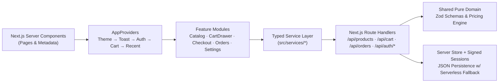

# Veloce Commerce

> A production-grade **Next.js App Router** e-commerce platform showcasing scalable **React Context API** state management, clean feature-based architecture, optimistic UI updates with automatic rollback, signed HTTP-only sessions, and automated testing.


---

## Overview

**Veloce Commerce** reimagines a classic Context API e-commerce architecture for the modern web using **Next.js App Router** and **TypeScript (strict mode)**. Rather than using Context API as a single monolithic store, this project demonstrates how to scale native React state management to production standards alongside full-stack API Route Handlers.

### Key Engineering Highlights

| Capability | Implementation Details |
| :--- | :--- |
| **Split Context Architecture** | `CartContext` splits `CartStateContext` and `CartActionsContext` backed by a pure `useReducer` state machine, preventing unnecessary re-renders across catalog grids. |
| **Optimistic UI & Rollback** | Cart mutations update instantaneously, sync to `/api/cart`, reconcile with server truth, and automatically roll back with toast feedback on network failure. |
| **Signed HTTP-Only Sessions** | Authentication uses HMAC-SHA256 signed cookies (`crypto.timingSafeEqual`) rather than insecure `localStorage` tokens, plus automatic guest-to-account cart merging on login. |
| **Server-Authoritative Pricing** | Pure domain pricing logic (`src/domain/pricing.ts`) is shared between UI previews and `POST /api/orders`, ensuring the server never trusts client-submitted totals. |
| **Runtime Schema Validation** | All API payloads, checkout forms, profile updates, and `localStorage` hydration are validated with **Zod**. |
| **Zero-FOUC Theme System** | `ThemeContext` supports `light`, `dark`, and `system` modes with OS media-query sync and a pre-paint initialization script to prevent white flash on reload. |
| **Recently Viewed LRU History** | `RecentlyViewedContext` maintains a deduplicated LRU browsing strip persisted safely via SSR-aware storage helpers. |
| **Automated Quality Gates** | Unit & integration test suite (**Vitest + React Testing Library**) + **GitHub Actions CI** running `typecheck`, `lint`, `test`, and `build`. |

---

## Architecture



For a deeper breakdown of architectural trade-offs and design decisions, see [`docs/ARCHITECTURE.md`](docs/ARCHITECTURE.md).

---

## Features

- **Storefront (`/`)**: Editorial hero, live keyword search, category filtering (`Furniture`, `Workspace`, `Apparel`), sorting, horizontal **Recently Viewed** strip, and responsive product grid.
- **Product Details (`/products/[slug]`)**: Statically generated product routes with technical specifications, quantity selector, automatic browsing history tracking, and related items.
- **Slide-Over Cart Drawer & Cart Page (`/cart`)**: Real-time quantity controls, live free-shipping progress bar ($250 threshold), promo code engine, and instant subtotal/discount calculations.
- **Authentication (`/login`)**: Email/password sign-in with one-click demo auto-fill, Zod validation, signed session cookie, and guest cart merging.
- **Protected Checkout (`/checkout`)**: Pre-filled delivery address from `AuthContext`, payment method selector, Zod form validation, server-verified order placement, and confirmation receipt.
- **Order History (`/orders`)**: Persisted history of completed orders with status badges, timestamps, and itemized receipts.
- **Settings (`/settings`)**: Visual Light / Dark / System theme picker, editable customer delivery profile, and one-click demo sandbox reset.

---

## Demo Credentials & Promo Codes

| Type | Value |
| :--- | :--- |
| **Demo Email** | `demo@veloce.store` |
| **Demo Password** | `veloce123` |
| **10% Off Coupon** | `WELCOME10` |
| **Free Shipping Coupon** | `FREESHIP` |

---

## Getting Started

### Prerequisites

- **Node.js 20+** (tested on Node 22)
- **npm 10+**

### Installation & Local Development

```bash
# 1. Clone the repository
git clone https://github.com/nathangrazo/teste.git
cd teste

# 2. Install dependencies
npm install

# 3. (Optional) Configure environment variables
cp .env.example .env.local

# 4. Start the development server
npm run dev
```

Open [http://localhost:3000](http://localhost:3000) in your browser. No external database or secondary API process is required — API persistence works out of the box via Next.js Route Handlers.

---

## Scripts

| Command | Description |
| :--- | :--- |
| `npm run dev` | Start Next.js dev server with Turbopack |
| `npm run build` | Build optimized production bundle |
| `npm run start` | Run production server |
| `npm run typecheck` | Run strict TypeScript check (`tsc --noEmit`) |
| `npm run lint` | Run ESLint with Next.js Core Web Vitals & TypeScript rules |
| `npm test` | Run Vitest unit & integration test suite |
| `npm run format` | Format source files with Prettier |

---

## Project Structure

```text
├── .github/workflows/ci.yml      # Automated CI pipeline
├── docs/ARCHITECTURE.md          # Architectural decisions & patterns
├── public/images/products/       # Cohesive studio product imagery
└── src/
    ├── app/                      # Next.js App Router pages & REST API route handlers
    ├── components/               # Reusable UI primitives & Navbar/Footer layout
    ├── contexts/                 # Theme, Toast, Auth, Cart (split), RecentlyViewed contexts
    ├── domain/                   # Pure TypeScript types, Zod schemas & pricing engine
    ├── features/                 # Feature-scoped client views
    ├── lib/                      # SSR-safe storage, formatters & className utilities
    ├── server/                   # Catalog data, signed session crypto & repository store
    └── services/                 # Typed API service clients
```

---

## License

MIT
